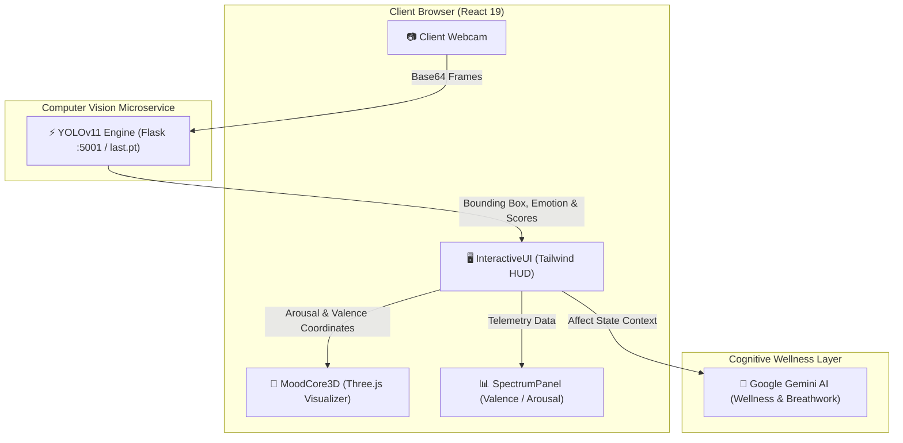

<div align="center">

# 🧠✨ MoodMate 3D — Real-Time Biometric Emotion AI & Wellness Core

**Next-Gen Affective Computing Platform Powered by YOLOv11 Neural Vision, Three.js 3D Visualizer, and Google Gemini AI**

[](https://react.dev/)
[](https://www.typescriptlang.org/)
[](https://threejs.org/)
[](https://ultralytics.com/)
[](https://ai.google.dev/)
[](https://tailwindcss.com/)
[](https://vitejs.dev/)

[Key Features](#-key-features) • [System Architecture](#-system-architecture) • [Emotion Telemetry](#-emotion-matrix--biometrics) • [Getting Started](#-getting-started) • [Tech Stack](#-tech-stack)

---

</div>

## 🌟 Overview

**MoodMate 3D** is an advanced affective computing system that bridges real-time facial micro-expression telemetry with reactive 3D spatial computing and generative cognitive wellness.

Using a fine-tuned **YOLOv11** neural vision engine, MoodMate detects multi-class emotions directly from a camera feed, computes continuous **Valence & Arousal** coordinates, and renders an interactive **Three.js 3D Living Mood Orb** that breathes, morphs, and shifts color dynamically with your affective state. When cognitive support is needed, **Google Gemini AI** delivers contextual somatic interventions, tactical breathwork protocols, and acoustic mood stabilization.

---

## 🚀 Key Features

### 👁️ 1. YOLOv11 Micro-Expression Detection
- High-frame-rate, local neural vision inference using a fine-tuned `last.pt` YOLO model.
- Classifies 9 distinct emotion states: **Happy, Natural, Surprised, Sad, Angry, Fear, Sleepy, Disgust, and Contempt**.
- Real-time facial bounding box tracking with dynamic confidence metrics.

### 🔮 2. Dynamic 3D Spatial Core (`MoodCore3D`)
- Interactive WebGL & Three.js reactive 3D sphere that morphs geometry, particle field density, rotation velocity, and chromatic gradients based on live emotional arousal.
- Smooth GSAP and physics-based particle transitions matching psychological valence states.

### 📊 3. Affective Spectrum & Biometric Telemetry
- **2D Circumplex Model of Affect**: Live mapping of emotional states along the **Valence** (pleasure/displeasure) and **Arousal** (activation/energy) dimensions.
- Per-frame micro-expression diagnostics (ocular openness, labial compression, zygomaticus major tension).

### 🧘 4. Gemini AI Wellness Copilot
- Personalized somatic grounding exercises (e.g., 4-7-8 Parasympathetic reset, tactical box breathing).
- Contextual acoustic grounding recommendations and mood recalibration coaching powered by Google's Gemini Multimodal models.

---

## 📐 System Architecture


## 🎭 Emotion Matrix & Biometrics

MoodMate continuously indexes emotional markers along two primary psychological axes:

| Affect Class | Primary Facial Action Markers | Valence (0–100) | Arousal (0–100) | Recommended Intervention |
| :--- | :--- | :---: | :---: | :--- |
| **😊 Happy** | Zygomaticus major activation, ocular radiance | **88** | **74** | High-energy flow optimization |
| **😐 Natural** | Balanced facial baseline symmetry | **68** | **40** | Mindfulness & focus maintenance |
| **😲 Surprised** | Frontalis elevation, wide palpebral aperture | **75** | **85** | Grounded attention orientation |
| **😢 Sad** | Inner-brow elevation, lowered oral commissures | **24** | **26** | Gentle acoustic grounding & warmth |
| **😡 Angry** | Corrugator contraction, labial compression | **18** | **90** | 4-7-8 Parasympathetic vagal reset |
| **😨 Fear** | Elevated upper lid, sympathetic alert tone | **26** | **86** | Tactical 4x4 Box Breathing |
| **😴 Sleepy** | Decreased blink velocity, periorbital relaxation | **52** | **18** | Circadian alignment & rest readiness |
| **🤢 Disgust** | Levator labii superioris alaeque contraction | **20** | **62** | Sensory reset & gaze refocus |
| **😒 Contempt** | Unilateral buccinator & zygomatic tension | **34** | **46** | Neutral reflective posture |

---

## 🛠️ Tech Stack

- **Frontend**: React 19, TypeScript, Tailwind CSS v4, Motion, Lucide Icons, Canvas Confetti
- **3D Graphics & Shaders**: Three.js, GSAP (GreenSock Animation Platform)
- **Neural Vision**: Ultralytics YOLOv11 (fine-tuned PyTorch weights: `last.pt`), Pillow, NumPy
- **AI Core**: `@google/genai` (Google Gemini 2.5 Flash / Pro)
- **Backends & Microservices**:
  - Express.js (Node.js/TypeScript server)
  - Flask + Flask-CORS (Python 3.10+ Neural Microservice)

---

## ⚡ Getting Started

### Prerequisites

Ensure you have the following installed:
- **Node.js** (v18.0.0 or higher)
- **Python** (v3.10 or higher)
- A working webcam

---

### Step 1: Clone the Repository

```bash
git clone https://github.com/<YOUR-USERNAME>/<YOUR-REPO-NAME>.git
cd <YOUR-REPO-NAME>
