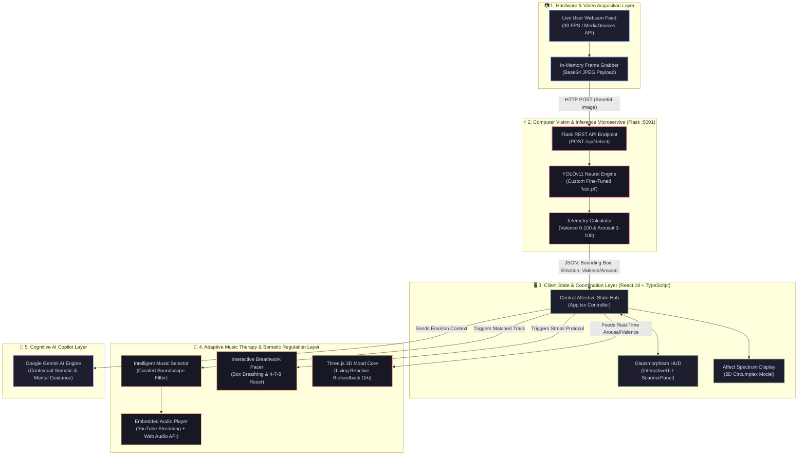

# 🧠✨ MoodMate — Real-Time Emotion Detection & Music Therapy

**An AI-Powered Facial Emotion Recognition System that Regulates Your Mood from Stressed, Sad, or Angry back to Calm, Focused, and Happy through Adaptive Music & Audio Therapy.**


[The Core Mission](#-the-core-mission) • [How Music Therapy Works](#-how-mood-regulation--music-therapy-works) • [System Architecture](#-enhanced-system-architecture) • [Emotion Matrix & Music Prescriptions](#-emotion-matrix--curated-music-prescriptions) • [Tech Stack](#-tech-stack) • [Getting Started](#-getting-started)

---


## 🎯 The Core Mission

Modern work, study, and daily screen time often trigger hidden stress, mental fatigue, burnout, and anxiety. Most people remain trapped in negative emotional states without even realizing it.

**MoodMate is built to break this cycle:**

1. **Scans Your Face in Real-Time**: Captures live micro-expressions through your camera using a custom fine-tuned **YOLOv11** neural network.
2. **Detects Your True Emotional State**: Accurately recognizes 9 affective classes: *Sad, Angry, Fear/Anxious, Sleepy, Disgusted, Contemptuous, Surprised, Neutral, or Happy*.
3. **Actively Regulates You Back to Normal or Happy**: Instantly selects and plays targeted **neuro-acoustic music, lo-fi tracks, and calming soundscapes** that scientifically counterbalance stress and lift your mood.
4. **Interactive Biofeedback**: Renders a reactive **Three.js 3D Living Orb** and guided breathing pacer so you can visually see and feel your stress melt away.

---

## 🎵 How Mood Regulation & Music Therapy Works

MoodMate does not just detect how you feel — **it actively works to make you feel better.**

```
   ┌──────────────────────────────────────────────────────────────┐
   │                    1. REAL-TIME CAPTURE                      │
   │      Webcam detects facial micro-expressions (30 FPS)        │
   └──────────────────────────────┬───────────────────────────────┘
                                  │
                                  ▼
   ┌──────────────────────────────────────────────────────────────┐
   │                 2. NEURAL VISION INFERENCE                   │
   │ YOLOv11 classifies emotion & computes Valence + Arousal score│
   └──────────────────────────────┬───────────────────────────────┘
                                  │
                                  ▼
   ┌──────────────────────────────────────────────────────────────┐
   │                3. ADAPTIVE REGULATION ENGINE                 │
   │  Is user stressed, angry, or sad? Target: Neutral / Happy    │
   └──────────────────────────────┬───────────────────────────────┘
                                  │
        ┌─────────────────────────┴─────────────────────────┐
        ▼                                                   ▼
┌─────────────────────────────────┐   ┌─────────────────────────────────┐
│     TARGETED MUSIC THERAPY      │   │    SOMATIC & 3D BIOFEEDBACK     │
│ • Sad     ➔ Uplifting Acoustic  │   │ • Living 3D Orb shifts to green │
│ • Angry   ➔ 432 Hz Calming Rain │   │ • Guided 4-7-8 Breathing Pacer  │
│ • Anxious ➔ Theta Binaural Beats│   │ • Gemini AI grounding advice    │
│ • Sleepy  ➔ Upbeat Focus Rhythm │   │ • Visual biofeedback loop       │
└────────────────┬────────────────┘   └─────────────────┬───────────────┘
                 │                                      │
                 └──────────────────┬───────────────────┘
                                    ▼
   ┌──────────────────────────────────────────────────────────────┐
   │                     4. DESIRED OUTCOME                       │
   │ Heart rate slows down, mood normalizes, smile is restored! 😊│
   └──────────────────────────────────────────────────────────────┘
```

---

## 🏗️ Enhanced System Architecture

Here is the complete multi-tier system architecture showing the exact end-to-end data pipeline from webcam frame capture to music regulation and cognitive assistance:



---

## 🎭 Emotion Matrix & Curated Music Prescriptions

MoodMate maps your detected emotion directly to a targeted intervention designed to stabilize your mood:

| Detected Emotion | Affective State | Goal | Prescribed Music / Sound Therapy | Interactive Biofeedback Action |
| :--- | :--- | :--- | :--- | :--- |
| **😢 Sad** | Low valence, low energy | **Uplift to Normal / Happy** | Warm acoustic melodies, uplifting lo-fi, melodic piano | Orb shifts to warm gold; dopamine-lifting visual lighting |
| **😡 Angry** | Low valence, high arousal | **Calm Down to Normal** | 432 Hz ambient drone, soft rainfall, tranquil nature sounds | Orb slows rotation to deep blue; 4-7-8 parasympathetic breath pacing |
| **😨 Fear / Anxiety** | Negative valence, acute tension | **Ground & Stabilize** | Theta binaural beats, peaceful instrumental acoustics | Orb pulses gently; 4x4 tactical box breathing activated |
| **😴 Sleepy** | Reduced blink speed, low focus | **Energize to Normal** | Upbeat electronic rhythms, bright lo-fi beats | Orb increases particle density; posture & alertness check |
| **🤢 Disgust** | Aversive facial tension | **Reset & Neutralize** | Flowing forest stream audio, crisp neutral white noise | Orb shifts to emerald; sensory reset and muscle relaxation |
| **😒 Contempt** | Asymmetrical tension | **Center & Balance** | Minimalist ambient piano, slow string harmonies | Reflective grounding and conscious facial release |
| **😲 Surprised** | Acute high arousal | **Orient & Calm** | Soft ambient pads, gentle wind chimes | Orb stabilizes geometry; steady breath pacing |
| **😐 Natural** | Balanced homeostatic baseline | **Maintain Harmony** | Chill study beats, smooth ambient coffee-shop audio | Continuous emotional monitoring and focus reinforcement |
| **😊 Happy** | High positive affect | **Celebrate & Reinforce** | Upbeat celebratory music, vibrant synthpop | Particle bursts, joyful celebratory confetti animations |

---

## 🚀 Key Technical Highlights

- **⚡ Ultralytics YOLOv11 Neural Vision**: Runs lightning-fast inference on webcam frames with a custom fine-tuned `last.pt` weight matrix, outputting real-time facial bounding boxes, class labels, and certainty metrics.
- **🎧 Seamless Music Therapy Engine**: Built-in soundscape player that automatically switches tracks to match the emotional need, supporting both YouTube music streaming and synthesized procedural Web Audio chimes.
- **🔮 Three.js & WebGL 3D Spatial Orb**: A custom 3D particle sphere that visually breathes, contracts, and shifts color in response to your live emotional arousal and valence scores.
- **🫁 Guided Somatic Breathwork**: Visual breathing pacer with audio cues for tactical breathwork routines (4-7-8 breathing and 4x4 box breathing) to lower autonomic nervous system arousal.
- **🤖 Google Gemini AI Copilot**: Integrates `@google/genai` to synthesize contextual psychological advice and calming prompts based on detected emotional shifts.
- **🎨 Modern Glassmorphism UI**: Built with React 19, TypeScript, and Tailwind CSS v4 for a fluid, dark-mode cyberpunk aesthetic.

---

## 🛠️ Tech Stack

| Domain                 | Technology                              | Purpose                                                  |
| :--------------------- | :-------------------------------------- | :------------------------------------------------------- |
| **Frontend Framework** | **React 19 + TypeScript**               | Reactive state coordination and UI rendering             |
| **Styling & HUD**      | **Tailwind CSS v4**                     | Ultra-responsive dark glassmorphism design               |
| **Computer Vision**    | **Ultralytics YOLOv11**                 | High-speed face & micro-expression detection (`last.pt`) |
| **Inference Backend**  | **Python Flask + Flask-CORS**           | Local REST inference microservice on port `5001`         |
| **3D Graphics**        | **Three.js + GSAP**                     | Real-time interactive 3D mood orb & particle effects     |
| **Audio & Music**      | **Web Audio API + YouTube**             | Procedural sound cues and curated mood-altering music    |
| **Cognitive AI**       | **Google Gemini (**`@google/genai`**)** | Intelligent wellness advice & personalized guidance      |
| **Bundler & Tooling**  | **Vite 6**                              | Instant hot-reloading and lightning-fast builds          |

---

## ⚡ Getting Started

### Prerequisites

Make sure you have installed on your machine:

- **Node.js** (v18.0.0 or higher)
- **Python** (v3.10 or higher)
- A working webcam

---

### Step 1: Clone the Repository

```bash
git clone https://github.com/<YOUR-USERNAME>/<YOUR-REPO-NAME>.git
cd <YOUR-REPO-NAME>
```

---

### Step 2: Configure Environment (Optional for Gemini AI)

```powershell
# Copy template configuration
cp .env.example .env.local
```

Inside `.env.local`, you can paste your free Gemini API Key from [Google AI Studio](https://aistudio.google.com/):

```env
GEMINI_API_KEY="your_actual_key_here"
```

*(Note: If you don't provide a key, the camera, YOLOv11 emotion scanner, music therapy, and 3D visualizer still work 100% offline!)*

---

### Step 3: Start the YOLOv11 Emotion Inference Service

Open a PowerShell terminal and launch the Python microservice:

```powershell
# Create & activate a virtual environment
python -m venv .venv
.\.venv\Scripts\activate

# Install dependencies
pip install flask flask-cors ultralytics torch pillow numpy

# Start the emotion detection microservice (Runs on port 5001)
python yolo_backend.py
```

> You should see:
> `Loading YOLOv11 model weights from last.pt...`  
> `✅ YOLOv11 Model loaded. Classes: ['angry', 'contempt', 'disgust', 'fear', 'happy', 'natural', 'sad', 'sleepy', 'surprised']`  
> `* Running on http://127.0.0.1:5001`

---

### Step 4: Start the React 3D Frontend & Music Player

Open a **second PowerShell terminal** in the same folder:

```powershell
# Install Node dependencies
npm install

# Start the frontend dev server
npm run dev
```

Open your browser and navigate to: `http://localhost:3000`

1. Allow webcam access.
2. Look at the camera — notice your detected emotion and valence/arousal stats on the HUD.
3. Open the **"Wellness & Sound"** panel to experience the music therapy tailored to your current mood!

---

## 📁 Repository Structure

```
MoodMate_React_3D/
├── src/
│   ├── components/
│   │   ├── ScannerPanel.tsx    # Live camera feed, YOLO bounding boxes & emotion tags
│   │   ├── WellnessPanel.tsx   # Music therapy player, curated YouTube soundscapes & breathwork
│   │   ├── MoodCore3D.tsx      # Three.js 3D living mood orb (spatial biofeedback)
│   │   ├── SpectrumPanel.tsx   # 2D Valence/Arousal emotion spectrum graphs
│   │   └── InteractiveUI.tsx   # Glassmorphism UI buttons, layout & HUD controls
│   ├── utils/
│   │   └── sound.ts            # Web Audio API procedural sound engine
│   ├── types/
│   │   └── mood.ts             # Emotion tokens, soundscape tracks & telemetry types
│   ├── App.tsx                 # Master state controller (links vision to music therapy)
│   └── main.tsx                # React 19 entry point
├── last.pt                     # Fine-tuned YOLOv11 model weights (36 MB)
├── yolo_backend.py             # Flask inference endpoint (/api/detect)
├── server.ts                   # Express server with Gemini AI support
├── vite.config.ts              # Vite 6 configuration
├── package.json                # Project dependencies and run scripts
└── README.md                   # Project documentation
```

---

## 🛡️ License & Acknowledgements

Developed as part of the **Infosys Springboard / Internship Program**.  
Distributed under the **MIT License**.

---


Crafted with ❤️ by **Shaik Farooq**  
*Empowering Mental Wellness Through Computer Vision, Spatial 3D, and Adaptive Music Therapy.*
